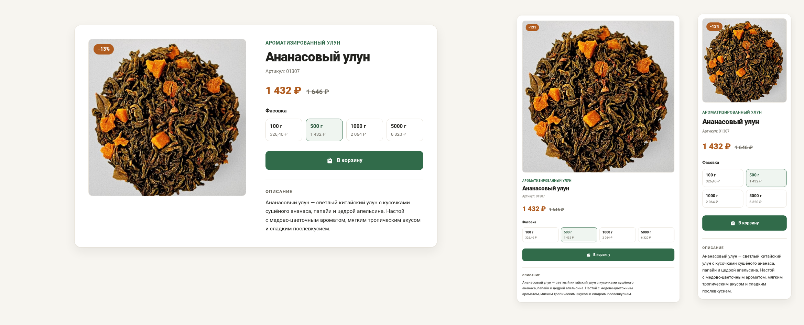

# Teaboom Card — карточка товара «Ананасовый улун»

[](https://github.com/IgorK62/teaboom-card/actions/workflows/ci.yml)
[](https://validator.w3.org/nu/?doc=https://igork62.github.io/teaboom-card/)
[](LICENSE)

**Живое демо:** https://igork62.github.io/teaboom-card/

Тестовое задание [Teaboom.ru](https://teaboom.ru): вёрстка верхней части
карточки товара [«Ананасовый улун»](https://teaboom.ru/product/ananasovij-ulun) —
изображение, название, категория, выбор фасовки, артикул, актуальная цена,
старая цена при наличии скидки, кнопка «В корзину», короткое описание.

## Скриншот



<sub>Слева направо: desktop 1440, tablet 768, mobile 375 — сетка перестраивается
в одну колонку, плитки фасовок 4 → 2×2.</sub>

## Запуск

Сборка не требуется — готовая страница лежит в репозитории:

```bash
# вариант 1: открыть файл напрямую
index.html

# вариант 2: любой статический сервер
python3 -m http.server 8080   # → http://localhost:8080
```

## Разработка

```bash
npm install        # sass как devDependency (единственная зависимость)
npm run sass       # пересобрать css/styles.css из scss/
npm run sass:watch # слежение при правке стилей
```

`css/styles.css` — сборка SCSS, руками не редактируется
(CI проверяет совпадение закоммиченного CSS с сборкой `scss/`).

## Структура проекта

```
teaboom-card/
├── index.html                  # семантичная разметка (BEM + Schema.org)
├── css/
│   └── styles.css              # сборка SCSS (не редактировать вручную)
├── scss/                       # компонентный подход 7-1: блок = файл
│   ├── abstracts/
│   │   ├── _variables.scss     # брейкпоинты, длительности, смягчения
│   │   └── _mixins.scss        # below(md) — медиазапросы из карты
│   ├── base/
│   │   ├── _tokens.scss        # палитра (SCSS-карта → CSS-переменные)
│   │   └── _base.scss          # reset, доступность, reduced motion
│   ├── layout/
│   │   ├── _page.scss          # контейнер страницы
│   │   └── _product.scss       # сетка карточки + миксы-слоты ритма
│   ├── components/
│   │   ├── _media.scss         # фото + бейдж скидки
│   │   ├── _category.scss      # ссылка на категорию
│   │   ├── _sku.scss           # артикул
│   │   ├── _price.scss         # цена
│   │   ├── _pack.scss          # выбор фасовки
│   │   ├── _button.scss        # кнопка «В корзину»
│   │   └── _description.scss   # описание
│   └── main.scss               # точка входа
├── js/
│   └── script.js               # vanilla JS, без зависимостей
├── img/
│   └── ananasoviy-ulun.jpg     # фото товара 1024×1024
├── docs/
│   └── screenshot.png           # скриншот для README (1440/768/375)
├── .github/
│   ├── workflows/ci.yml        # сборка + W3C + smoke
│   └── scripts/check-w3c.py    # валидация HTML (W3C nu)
├── package.json                # npm-скрипты (sass)
├── .editorconfig               # единый стиль для редакторов
└── README.md
```

## Функциональность (по заданию)

- переключение фасовки **100 г / 500 г / 1000 г / 5000 г** обновляет цену,
  старую цену, артикул и выбранное состояние плитки;
- бейдж скидки на фото пересчитывается автоматически (−7…−27 %);
- кнопка «В корзину»: обычное состояние, hover (фон темнеет), нажатие и
  короткий отклик «Добавлено ✓» — реальную корзину подключать не требуется;
- адаптивность: **1440 / 768 / 375** — Grid + Flexbox; на планшете и
  мобильном карточка перестраивается в одну колонку, плитки фасовок —
  в сетку 2×2 (меньше 640 px).

## Семантика и БЭМ

- строгий БЭМ: `.media`, `.price`, `.pack`, `.button`, `.description`,
  `.category`, `.sku` — самостоятельные блоки (файл на блок); `.product`
  владеет только раскладкой и задаёт вертикальный ритм через **миксы**
  (`.price.product__price`); модификаторы — `.button--primary`,
  `.button--added`, состояние `.price.is-updated`;
- семантический HTML5: `article`, `figure`, `header`, `section`,
  `fieldset + legend`, `h1/h2`, `<s>` для неактуальной цены;
- микроданные Schema.org `Product` + `Offer` (цена, валюта, sku,
  наличие) — обновляются скриптом вместе с интерфейсом;
- доступность: фасовки — нативные `radio` (стрелки, пробел), видимый
  фокус, `aria-live` на цене, «Старая цена:» для скринридеров
  (`visually-hidden`), `prefers-reduced-motion`.

## Производительность

- ноль внешних запросов: системные шрифты, один CSS (~6 КБ) и один JS
  (~3.5 КБ), одно изображение (JPEG 167 КБ; формат совпадает с расширением);
- LCP-изображение: `rel=preload` + `fetchpriority="high"` на ``;
- `width`/`height` у изображения — нулевой layout shift (CLS = 0);
- скрипт подключён с `defer`, не блокирует рендер.

## Проверки

| Проверка | Результат |
|---|---|
| W3C Nu validator | 0 ошибок |
| WCAG AA контраст (12 пар токенов) | все ≥ 4.78:1 |
| Клавиатура (Tab, стрелки на radio, фокус) | работает |
| Консоль браузера (1440/768/375) | 0 ошибок |
| CLS / LCP | 0 / < 100 мс локально |

CI прогоняет сборку SCSS, проверку совпадения CSS с сборкой,
W3C-валидацию и smoke-тест доступности страницы и ресурсов.

## Технологии

HTML5 · SCSS (`@use`-модули, карты, миксины) · vanilla JavaScript ·
BEM · Flexbox/Grid. Без фреймворков, Bootstrap и готовых шаблонов.

## Лицензия

[MIT](LICENSE)